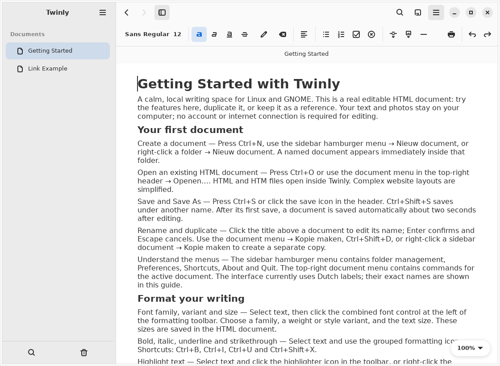

# Twinly

A calm native GTK4/libadwaita writing application for Linux and GNOME. Write rich
text, embed photos, connect HTML documents and keep a reference beside your work.
Documents are standalone editable HTML files. No server, account or cloud service
is required. The interface and bundled Getting Started guide are in
English and includes an embedded sample photo and a working internal link.

This repository is prepared as a **0.4.0 preview**, not a published Flathub release.
Developed by Paullinux and licensed under [GPL-3.0-or-later](LICENSE).
See [publishing instructions](docs/PUBLISHING.md) and [third-party licensing](LICENSING.md).
The About Twinly window shows the version, license, project links and credits.



## Run from source

Requirements: Python 3.10+, PyGObject, Pycairo, GTK 4.12+ and libadwaita 1.4+.

Arch Linux:

```sh
sudo pacman -S python python-gobject python-cairo gtk4 libadwaita
bash start.sh
```

Ubuntu 24.04:

```sh
sudo apt install python3-gi python3-cairo python3-gi-cairo gir1.2-gtk-4.0 gir1.2-adw-1
bash start.sh
```

Use the distribution's Python, not a pip-only virtual environment. You can pass
`--root /absolute/path` to import an existing workspace folder, or HTML filenames
to import documents into the selected standard workspace.

## First start and storage

A fresh installation copies `Getting Started.html` and `Link Example.html` to a
writable Starter Workspace and opens Getting Started. The guide describes every
current feature, its menu/toolbar entry or shortcut, and relevant limitations.
The approved writing-desk photo is embedded in the HTML and works offline.
Templates are copied once; existing user documents are never overwritten.

Default native locations:

- Workspace data: `$XDG_DATA_HOME/twinly/Workspaces/` (usually `~/.local/share/...`).
- Workspace Trash and recovery: alongside `Workspaces/` in the same Twinly folder.
- Preferences: `$XDG_CONFIG_HOME/twinly/preferences.json` (usually `~/.config/...`).
- A legacy source installation with `Instellingen/voorkeuren.json` keeps using its
  existing portable settings/workspaces. Packaged installs always use XDG locations.

Flatpak supplies private XDG directories under `~/.var/app/APP_ID/`. Choose another
root through the sidebar menu when you want to keep your documents elsewhere.
Installing app files under a read-only prefix never requires writing into `/app`.

## Install a native user copy

```sh
python3 scripts/install.py --prefix "$HOME/.local"
"$HOME/.local/bin/twinly"
```

The installer registers the launcher, desktop entry, icon and AppStream metadata.
It does not change your default HTML application or copy personal documents.

## Build and install a Flatpak

Install `flatpak` and `flatpak-builder`, then run:

```sh
sh scripts/build-flatpak.sh
flatpak install --user dist/Twinly-0.4.0.flatpak
flatpak run io.github.twinly.Preview
```

The manifest uses the GNOME 51 platform/SDK. Building downloads the runtime and
SDK; normal editing is offline. The GitHub **Build Flatpak preview** workflow can
also build the bundle and store it as a downloadable workflow artifact. It does
not publish releases or submit to Flathub automatically.

Permissions: Wayland/fallback X11, graphics/IPC and CUPS printing. The manifest
requests no blanket Documents/home access, host-trash/GVfs grants or shared networking.
Choose additional files and workspace folders through the file portal. In Flatpak,
workspace Trash stays inside Twinly’s managed data folder. Document trash uses
`.twinly-trash` within each managed standard workspace, on native and Flatpak installs. Verify folder grants, trash,
printing and blur in an actual sandbox before release.

See [SECURITY.md](SECURITY.md) for import limits, safe file operations, private storage
permissions and remaining limitations. HTML documents are not encrypted.

## Main features

- Font family, variant and size; bold, italic, underline, strike and alignment.
- Seven highlight colours and clear-highlight swatch; selection context palette.
- Bullets, numbered items, checkboxes, clear formatting and horizontal rules.
- Embedded PNG/JPEG photos, proportional drag resizing and numeric width controls.
- Relative internal links, external links and choosing where linked documents open.
- Real folder tree, inline renaming, moving, document copies, trash and restoration.
- Document-name/path overview search, in-document search and back/forward navigation.
- Two panes, shared controls, pinned references, swapping and normal-exit restoration.
- Autosave, visible save recovery, undo/redo and external-change protection.
- Print preview, paper/orientation/margins, PDF, ODT and Word (.docx) export and printing.
- Zoom, light/dark/system appearance and optional runtime/compositor-dependent blur.
- Shortcut overview through the sidebar menu or Ctrl+?.

No tables, fixed-page editing, nested lists, full-workspace body search, cloud sync or
crash recovery for never-saved documents are claimed. Simple lists use text prefixes.

## Tests

```sh
python3 scripts/check_release.py
xvfb-run -a /usr/bin/python3 -m unittest discover -s tests -v
```

On a desktop you can omit `xvfb-run -a`. GTK, PyGObject and Cairo must be installed.
The installer also supports `--destdir` for a staged install. See REVISIE.md for the
technical revision, measured benchmarks and limits of the available test environment.

### Upgrading from Weave Docs

Twinly is the new name. Replace the application code and `data/` folder while
keeping your own `Documenten/` and `Instellingen/` folders. Existing native XDG
preferences and documents under `weave-docs` are reused in place if Twinly has
no preferences yet. Existing `.weave-trash` content remains accessible.
A changed Flatpak app ID has a separate sandbox; grant access to your existing
library through the folder chooser. Its old sandbox settings are not imported
automatically. The app ID remains provisional until publication is configured.

### Export

Use the document menu → **Export as…** → PDF, OpenDocument (`.odt`) or
Word (`.docx`). PDF uses the print preview and its paper/margin controls.
Office formats save a separate editable file with text, supported formatting,
links and embedded photos; the original HTML and unsaved edits are preserved.
Font variants may be approximated as regular, bold or italic. Simple list and
checkbox prefixes remain text. Internal links continue to reference the HTML
library and are rebased to the export folder. Layout depends on the receiving
program and available fonts. No LibreOffice installation or network access is
required for export. ODT and DOCX import is available separately through Import….

### Import ODT and Word

Document menu → **Import…** accepts `.odt` and `.docx` (not legacy `.doc`).
The confirmation explains conversion to HTML and potential changes on subsequent
export. Choose a new HTML destination after conversion. The source is never
modified, existing HTML is never overwritten, and unsaved editor changes are
guarded. Supported text formatting, simple list prefixes, links and embedded
PNG/JPEG photos are carried over. Tables flatten into cell text; footnotes,
tracked changes, headers/footers, page layouts and unsupported objects can be
omitted or simplified. Conversion is offline without macros or remote resources.
Encrypted files and oversized or overly complex packages are rejected.

### Import PDF text

Document menu → **Import…** also accepts PDFs with an existing text layer.
A separate notice explains that only text is converted to an HTML copy: photos,
links, fonts and page geometry are not retained, and reading order may change.
No OCR is performed. Image-only PDFs and encrypted PDFs are rejected. In mixed
files the user is told how many pages had no extractable text. The original
PDF stays untouched. The bundled BSD-3-Clause pypdf library runs in a separate
Python process with CPU, wall-time, output and memory limits; there are no new
packages to install and conversion works offline, including in Flatpak.

### Floating toolbar

The formatting toolbar is always a compact, centered floating pill over the
writing area, shown by hovering near its top and hidden after leaving the
controls. It sits below the shared headerbar and uses the blur settings when
supported. Appearance is instant, without animation. The minimum content width
keeps the toolbar on one row. Menus and font dialogs remain usable.

### Dark interface with a light document

Preferences has a fourth circular theme choice: **Dark + Light**.
Its dark circle contains a small white rounded document. The sidebar, floating
toolbar and menus use the dark theme; the shared document headerbar stays light,
and both writing panes stay white with
dark text and a dark caret. Selection retains the accent colour. The choice is
saved and works with blur; documents and exports are unchanged.

### Workspaces

Click **Workspaces** in the left sidebar to open a dropdown of existing workspaces.
Choose **More…** to open the right-hand management pane.
First launch includes one **Starter Workspace**, labelled **Not encrypted**, with
the complete Getting Started document. Create your own workspace before storing
personal documents: enter a name and explicitly choose **Standard — Not encrypted**
or **Encrypted — Password protected**. Every standard workspace receives the full
guide; encrypted workspaces start empty. There is no default encrypted workspace.

The sidebar dropdown switches workspaces in the **same window**. Workspace names
and protection icons appear in the dropdown. **More…** opens the right-hand panel
for creating, naming, importing and Trash.
Standard workspaces offer Save / Discard / Cancel for dirty documents in either
pane. Leaving an encrypted workspace saves its documents and recovery drafts,
locks it and wipes its editor. Failed saves block switching; cancelling an unlock
or entering a wrong password leaves the current workspace open. Open documents,
pane layout, zoom and scroll positions are remembered per workspace; encrypted
session state stays inside encrypted storage.

Protection icons appear beside each workspace name: an open padlock for standard,
a closed padlock for encrypted and locked, and an open padlock with a shield for
encrypted and unlocked. Labels and tooltips make the distinction explicit.
Rename workspaces in the list; their storage IDs remain stable.

All workspace data lives in Twinly’s XDG data folder (normally
`~/.local/share/twinly`, or the corresponding Flatpak data directory):

- `Workspaces/`: managed standard and encrypted workspace folders.
- `Workspace Trash/`: deleted workspaces, with restore and permanent-delete controls.
- `Recovery/`: recovery drafts for standard documents.
- `workspaces.json`: names, protection types and storage IDs; no passwords or encrypted document names.

Existing libraries and encrypted vaults are copied and verified during migration;
originals remain untouched. **Import workspace** does the same for another folder.
Copies reject symbolic links and special files, and abort if the source changes.
Unavailable sources are reported; use Import workspace when they are available.
External HTML documents open as managed copies; use Export for files outside Twinly.

Moving a workspace to Trash requires confirmation. Permanent deletion requires a
second warning. Encrypted workspaces must be locked first and remain encrypted in
Trash. Document Trash remains separate from Workspace Trash.

### Reading and editing

Existing documents open read-only. A persistent pencil beside each pane's title
turns on editing and reveals the formatting toolbar. The pencil becomes a
checkmark: click it to save and return to reading. If saving fails or is cancelled,
the document remains editable. Selecting, copying, searching, following links and
printing remain available while reading. Each pane has its own editing state,
including vault documents; newly created documents start editable.

### Shared document title

Document titles and their close buttons stay visible in the shared headerbar.
A thin blue underline identifies the active document. Hovering over a document
selects its pane for typing while preserving its read/edit setting. Click the
title to rename it inline, or right-click it for pin/swap/rename/close commands.
With two panes, hovering, clicking inside a document or pressing F6 switches
editing panes. Closing follows Ctrl+W:
close the active pane, or the application when only one pane remains.

### Writing tools

The toolbar offers Body, Title, Subtitle, Heading 1–3 and Quote paragraph styles.
The headerbar outline icon (Ctrl+Shift+L) navigates headings in the active document.
Ctrl+H opens find-and-replace, with whole-word and case options; replacement is undoable.
Private recovery drafts are written after a one-second editing pause, including unnamed documents.
After an unexpected exit, a notification or the sidebar menu offers recovery as a new document,
without overwriting the original. Drafts in another live Twinly window are excluded.
The font chooser now uses an icon; its tooltip displays the font and size.

Custom styles are created from the paragraph-style menu, with a name, base role,
font/size chooser and preview. Manage Styles edits the shared style library;
changes apply when a style is chosen again. Applied definitions travel inside
the HTML document as validated data attributes plus ordinary inline formatting.
Manual overrides retain heading semantics and show an asterisk in the style selector.
Fonts are referenced by family name and are not embedded.

### Encrypted workspaces (preview)

On Arch Linux install `python-pynacl` (PyNaCl 1.6.2 or newer). Standard editing
works without it. Choose **New workspace**, name it and select **Encrypted**.
Set a password of at least 12 characters and save the recovery key separately.
Documents, folders, embedded pictures, recovery drafts, trash and custom styles
are encrypted at rest. The header lock icon locks the workspace; inactivity locks
after five minutes by default. Unlocking uses its password or recovery key.
Names of workspaces and their protection status are visible in the normal list;
passwords, recovery keys and encrypted document names are never stored there.
The existing encryption format and password/recovery behavior are unchanged.
Read [docs/VAULT.md](docs/VAULT.md) before storing sensitive material.
This preview has not undergone an independent security audit.
