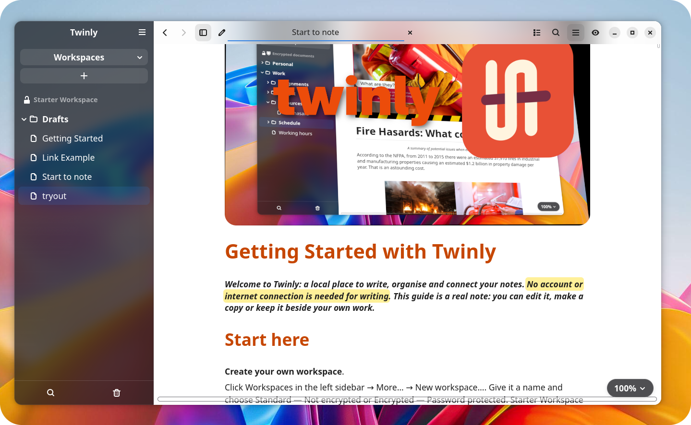

# Twinly

**A calm, local writing space for Linux.**

Write rich-text notes, organise them into workspaces, connect them with links,
and keep a reference open beside your work. Choose a standard or encrypted
workspace. Writing works offline, with no account, server or cloud service.



Built with GTK4 and libadwaita. Developed by **Paullinux**, with LLM-assisted
development, and licensed under **[GPL-3.0-or-later](LICENSE)**.

## What you can do

- **Organise your notes.** Create named workspaces, folders and notes. The sidebar
  **+** offers **New note** and **New folder** in the current workspace. Rename
  items inline or move them between folders.
- **Choose encryption.** Create password-protected workspaces with a recovery
  key and automatic locking. Notes, folder names, photos, recovery drafts and
  document Trash are encrypted at rest.
- **Write comfortably.** Use paragraph styles, custom styles, text colours,
  highlighting, alignment, bullets, numbered lists and checkboxes. The formatting
  toolbar appears on hover; the eye button can keep it visible.
- **Read before editing.** Existing notes open read-only. Click the pencil to
  the left of a title to edit; its checkmark saves and returns to reading.
- **Work with two notes.** Open beside, pin a reference, swap panes and adjust
  the divider. Titles stay visible, and a blue underline marks the active note.
- **Find and navigate.** Search note names and paths in the right-hand panel,
  find text within a note, use find-and-replace, or navigate its heading outline.
- **Add photos and links.** Embed PNG/JPEG photos, resize them proportionally,
  link to other notes, or open websites in your browser.
- **Import and export.** Import HTML, ODT, DOCX and selectable PDF text. Export
  HTML, PDF, ODT or DOCX, or use print preview and physical printing.
- **Recover and restore.** Named notes autosave. Recovery drafts help after an
  unexpected exit; document Trash and Workspace Trash offer restoration before
  permanent deletion.
- **Make it yours.** Choose System, Light, Dark or Dark + Light, adjust document
  zoom, and enable background blur where your GTK/Wayland setup supports it.

The interface and bundled **Start to note** guide are in English. Documents
use bundled **Noto Sans Regular** for Body (12 pt), and **Noto Sans Bold** for
Title (28 pt) and Headings 1–3 (24, 20 and 17 pt). Italic, bold italic, underline
and custom font choices are supported. Exported HTML references fonts rather
than embedding them for other applications.

## Start writing

1. Open **Workspaces → More… → New workspace…**. Give it a name and choose
   **Standard — Not encrypted** or **Encrypted — Password protected**.
2. Click **+ → New note**, enter a name and start writing. **New folder** uses
   the same menu. New items use the selected folder when applicable.
3. Hover near the top of the document for formatting controls. Use **Ctrl+S**
   to save, or the editing checkmark to save and return to reading.
4. Use the sidebar Search or Trash button to open its right-hand pane. Click
   the same button again to close it. **Workspaces → More…** opens workspace
   management in that panel area; your document panes stay in place.

First launch includes an unencrypted **Starter Workspace** with **Start to note**
and a working **Link Example** note. Every new standard workspace receives the guide;
encrypted workspaces start empty. Existing notes and edited guide copies are
never replaced by a template update.

## Run from source

Requires Linux, Python 3.10+, PyGObject, Pycairo, GTK 4.12+ and libadwaita 1.4+.
Use your distribution's Python so the GTK bindings are available.

Clone the repository and enter it:

```sh
git clone https://github.com/paullinux-gn/twinly.git
cd twinly
```

**Arch Linux**

```sh
sudo pacman -S python python-gobject python-cairo gtk4 libadwaita
bash start.sh
```

For encrypted workspaces, also install `python-pynacl`. Twinly requires
**PyNaCl 1.6.2 or newer**; standard workspaces work without it.

**Ubuntu 24.04**

```sh
sudo apt install python3-gi python3-cairo python3-gi-cairo gir1.2-gtk-4.0 gir1.2-adw-1
bash start.sh
```

See [encrypted workspace requirements](docs/VAULT.md) for the crypto dependency
and recovery details. A pip-only environment without GTK bindings is insufficient.

Passing `--root /absolute/path` imports an existing workspace folder. Opening
external HTML files imports managed copies into the selected standard workspace;
the originals are kept.

### Install a native user copy

```sh
python3 scripts/install.py --prefix "$HOME/.local"
"$HOME/.local/bin/twinly"
```

The installer includes the launcher, desktop entry, icon, AppStream metadata,
fonts, introduction templates and required licence notices. It does not copy
personal documents or change your default HTML application.

### Build and install a Flatpak

Install `flatpak` and `flatpak-builder`, then run:

```sh
sh scripts/build-flatpak.sh
flatpak install --user dist/Twinly-0.4.0.flatpak
flatpak run io.github.twinly.Preview
```

The manifest uses the **GNOME 51** platform and SDK and builds the pinned crypto
dependencies. Building downloads dependencies; normal writing works offline.
The GitHub **Build Flatpak preview** workflow can also produce a downloadable
workflow artifact. It does not publish to Flathub automatically.

The current version is **0.4.0**, with Flatpak application ID
`io.github.twinly.Preview`. There is no published Flathub release at present.
See [publishing instructions](docs/PUBLISHING.md) for release preparation.

The Flatpak requests Wayland/fallback X11, graphics/IPC and CUPS printing, with
no blanket home/Documents access or shared networking. Additional imports use
the file portal. Actual portal, compositor and printer behaviour should be
checked on your target desktop.

## Your data and privacy

Twinly keeps workspaces inside its own managed data folder. Standard notes are
editable **HTML files**, including embedded photos and relative internal links.
Encrypted workspaces store encrypted data; exporting creates a separate,
unencrypted copy and requires confirmation.

Default native locations:

| Content | Location |
| --- | --- |
| Workspaces | `$XDG_DATA_HOME/twinly/Workspaces/` |
| Deleted workspaces | `$XDG_DATA_HOME/twinly/Workspace Trash/` |
| Standard-workspace recovery | `$XDG_DATA_HOME/twinly/Recovery/` |
| Preferences | `$XDG_CONFIG_HOME/twinly/preferences.json` |

Without XDG overrides, these are under `~/.local/share/twinly/` and
`~/.config/twinly/`. Flatpak uses private directories under
`~/.var/app/io.github.twinly.Preview/`. Legacy installations may retain their
existing storage location; migration copies and verifies source data and leaves
originals intact. Back up your data before upgrading or reorganising it.

Document Trash belongs to its workspace and is separate from **Workspace Trash**.
Encrypted recovery and document Trash stay encrypted. Workspaces must be locked
before moving them to Workspace Trash, where they remain encrypted.

Encrypted workspaces require a password of at least 12 characters. Save the
recovery key separately: losing both means losing access to the data. Inactivity
locks after five minutes by default, with 1, 5, 15 or 30 minutes selectable.
Encryption protects stored workspace content, not imported originals, exports,
clipboard history or an unlocked application. Workspace names and protection
status remain visible in the workspace list.

Read [SECURITY.md](SECURITY.md) and [the encrypted workspace guide](docs/VAULT.md)
for safeguards and limitations. Automatic saving, recovery and Trash complement
regular backups; they do not replace them. Encryption has not undergone an
independent security audit.

## Import, print and export

- **HTML:** Open imports a managed copy. Standard notes remain portable HTML;
  keep linked collections together when moving them to another computer.
- **ODT and DOCX:** Import converts supported text, formatting, links, simple
  lists and embedded photos. Complex layouts, tables, footnotes and tracked
  changes may be simplified or omitted. Legacy `.doc` and password-protected
  Office files are unsupported. No macros or remote images are loaded.
- **PDF:** Import reads selectable text only. Images, fonts, links and page
  layout are not retained. Image-only scans need OCR, which Twinly does not
  provide. Password-protected PDFs are unsupported. PDF text can be imported
  directly into encrypted workspaces.
- **Export:** The standard document menu's **Export as…**, below **Save as…**,
  offers HTML, PDF, ODT and DOCX. Encrypted workspaces have corresponding export
  commands. Exports preserve the active note; layout in other applications can
  vary with their rendering and installed fonts.
- **Printing:** **Ctrl+P** opens preview with A4, A5 or Letter, orientation and
  margin controls, plus **Save PDF…**. **Ctrl+Shift+P** prints. The editor flows
  with the window; print line breaks follow paper width and may differ.

Office conversion is built in, and PDF text import uses bundled pypdf in a
resource-limited subprocess. Neither requires LibreOffice or an online service.

## Capacity and current limits

Workspace Search uses virtual rows to keep large result lists manageable. Tests
exercised **30,000 documents across 3,000 folders**. Automatic filesystem
monitoring is capped at **2,000 folders**; additional folders remain searchable
but do not refresh automatically. Large directory scans remain synchronous and
may pause the interface on slow storage.

Document limits include **4 MiB of UTF-8 text**, **20,000 paragraph breaks**,
**16,384 characters per paragraph**, and **20,000 formatting spans**. Oversized
input is rejected rather than shortened. Encrypted workspaces support at most
**10,000 items**, including folders and trashed items. Image and import budgets
are detailed in [SECURITY.md](SECURITY.md).

Tables, fixed-page editing, nested lists, full-workspace body search and cloud
synchronisation are not provided. The
[maintenance and scalability review](docs/MAINTENANCE-REVIEW-2026-11-05.md)
records measurements, security checks and remaining issues, including a GTK 4.14
tooltip teardown issue observed in an extra-wide automated test run.

## Development and checks

With the system GTK/Python dependencies installed:

```sh
python3 scripts/check_release.py
xvfb-run -a /usr/bin/python3 -m unittest discover -s tests -v
```

On a desktop, `xvfb-run -a` can be omitted. The starter note is maintained directly in `data/Start to note.html`: edit it
in Twinly and export the HTML, keeping images embedded and bundled links relative.
`check_release.py` validates it; there is no text generator to overwrite its
formatting or screenshots. Installation supports `--destdir` for staging.

Useful references:

- [Contributing](CONTRIBUTING.md)
- [Security safeguards](SECURITY.md)
- [Licensing and third-party notices](LICENSING.md)
- [Publishing](docs/PUBLISHING.md)
- [Latest audit and benchmarks](docs/MAINTENANCE-REVIEW-2026-11-05.md)
